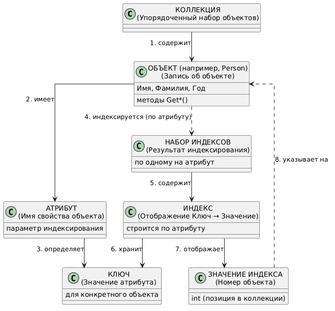

# laba2_cpp_3sem

Задача: написать программу, которая строит индекс по колекции объектов (Person) - то есть ассоциативный массив "значение атрибута - список объектов с этим атрибутом". Индекс можно построить двумя разными структурами (BST, хеш-таблица). Нужно замерить время построения и поиска для каждой структуры на одних и тех же данных, сравнить, выгрузить в CSV, покрыть тестами, дать графический UI.
Это задача И-5 "Индексирование данных" + M-5/M-5.1(Разрешение коллизий с помощью списков)/M-5.2(Разрешение коллизий с помощью смещения адресов)

Обоснование выбора структуры для задачи индексирования
Вы правильно поняли: индексация — это про доступ и упорядочивание. Разберу, какая структура больше всего подходит именно для этой задачи, и как это обосновать письменно.

1. Что такое «индекс» в задаче И-5
Индекс — это структура, которая по ключу (значению атрибута) возвращает значение (номер Person). Ключевые свойства индекса:

Быстрый доступ по ключу — Get(key) за O(1) или O(log n), не O(n).

Упорядоченность — обход в порядке возрастания ключей (для range-запросов, И-5.1).

Биекция — каждому ключу ровно одно значение (в строгой постановке).

Динамичность — вставка/удаление без перестройки всей структуры.

Это ровно свойства B-дерева / BST, а не хеш-таблицы. Хеш-таблица даёт только (1) и (4), но не (2), и не (3) в случае цепочек. Поэтому для индексации в СУБД используют B-деревья / B+-деревья, а не хеш-таблицы.

2. Сравнение структур по критериям индексации
Критерий	BST	B+-дерево	Хеш (цепочки)	Хеш (открытая адресация)
Доступ по ключу	O(log n)	O(log_B n)	O(1) средн.	O(1) средн.
Упорядоченность	✅ обход	✅ обход + листья связаны	❌	❌
Range-запросы	✅	✅ (лучше всех)	❌	❌
Биекция ключ → ячейка	✅ узел	✅ лист	❌ бакет = список	✅ слот
Коллизии	❌ нет	❌ нет	✅ есть	✅ есть (пробы)
Детерминированность	✅ всегда O(log n)	✅ всегда O(log_B n)	❌ зависит от хеша	❌ зависит от хеша
Сложность реализации	Средняя	Высокая	Низкая	Низкая
«Как в СУБД»	Частично	✅ эталон	❌	❌
У вас уже есть	✅ (ЛР-1)	❌	❌	❌
3. Какая структура больше всего подходит
Эталон для индексации — B+-дерево
В реальных СУБД (PostgreSQL, MySQL, Oracle) индексы — это B+-деревья (или их варианты). Причины:

Упорядоченность — обход в порядке возрастания, range-запросы (WHERE age BETWEEN 20 AND 30) — O(log n + k).

Биекция — каждый ключ в листе, значения только в листьях, листья связаны — идеально для индекса.

Логарифмическая высота — log_B n (B = 100–1000), меньше чем log₂ n у BST. Для n = 10⁶ — 3–4 уровня vs 20 у BST.

Диск-ориентированность — узел = страница диска (4–16 КБ), одно чтение = один узел. Меньше обращений к диску.

Но: B+-дерево сложно в реализации (~800 строк, 20+ граничных случаев). Для ЛР-2 — избыточно.

Для вашей ЛР-2 — BST (основная) + хеш с открытой адресацией (альтернатива)
BST — основная, потому что:

Упорядоченность — обход в порядке возрастания, range-запросы возможны (потенциал И-5.1).

Биекция — каждый ключ = отдельный узел, нет «двух ключей в одном узле».

Нет коллизий — не зависит от хеш-функции.

Детерминированность — всегда O(log n) на случайных данных.

Уже есть из ЛР-1 — переиспользование.

Соответствует M-3 (бинарное дерево) — базовая структура для индексирования.

Хеш с открытой адресацией — альтернатива, потому что:

Биекция ключ → слот — отвечает на замечание преподавателя (в отличие от цепочек).

O(1) в среднем — быстрее BST на поиске.

M-5.2 закрыта (7 баллов).

Сравнение с BST: O(1) с пробами vs O(log n) без коллизий — содержательно.

Цепочки (M-5.1) — не подходят, потому что:

Нарушают биекцию — в одном бакете список ключей.

Неупорядочены — range-запросы невозможны.

«Список списков», а не индекс.

4. Обоснование для ТЗ (дословно)
Вот готовый текст для раздела «Обоснование выбора структуры»:

Обоснование выбора структуры данных.

Задача индексирования (И-5) требует структуры, которая обеспечивает быстрый доступ по ключу, упорядоченность (для range-запросов) и биективное отображение ключ → значение. В СУБД для этих целей традиционно используются B-деревья / B+-деревья, а не хеш-таблицы, именно из-за упорядоченности и поддержки диапазонных запросов.

В рамках ЛР-2 в качестве основной структуры выбрано бинарное дерево поиска (TreeIndex, M-3), потому что:

Упорядоченность: BST поддерживает обход в порядке возрастания ключей, что позволяет реализовать range-запросы (потенциальное расширение И-5.1). Хеш-таблица этого не даёт.

Биекция: каждый ключ соответствует отдельному узлу, отображение ключ → значение взаимно-однозначно. В отличие от хеш-таблицы с цепочками, где в одном бакете хранится список ключей, BST не допускает «двух ключей в одном узле».

Отсутствие коллизий: BST не зависит от качества хеш-функции, время поиска детерминировано — O(log n) на случайных данных.

Переиспользование: BST реализован в ЛР-1 (3 семестр) и подключается как сабмодуль.

В качестве альтернативы реализована хеш-таблица с открытой адресацией (HashIndexOpen, M-5.2), потому что:

Биекция: каждый слот хранит ровно один ключ; при коллизии ключ смещается в следующий свободный слот, но слот остаётся «один ключ — один слот». Это отвечает требованию индекса как биективного отображения.

O(1) в среднем на поиск — быстрее BST, что даёт содержательное сравнение: «O(log n) без коллизий vs O(1) с пробами».

M-5.2 закрыта.

Хеш-таблица с цепочками (M-5.1) не выбрана как основная, потому что в одном бакете хранится список ключей, что нарушает биекцию ключ → значение, необходимую для индекса в строгой постановке. Цепочки — это «список списков», а не индекс.

B+-дерево является эталонной структурой для индексации в СУБД (упорядоченность + range-запросы + логарифмическая высота), но не реализуется в ЛР-2 из-за высокой сложности (~800 строк, 20+ граничных случаев) и достаточности BST для демонстрации основных свойств индекса. B+-дерево указано как направление развития (см. раздел «Оригинальность»).

5. Если преподаватель настаивает на B+-дереве
Тогда выбор — B+-дерево (основная), BST — альтернатива. Обоснование:

«B+-дерево — эталон для индексации: упорядоченность, range-запросы, логарифмическая высота, биекция ключ → лист. BST — альтернатива, проще, но без range-запросов на листьях. Хеш-таблица — не подходит для индексации, потому что неупорядочена и не поддерживает range-запросы.»

Но B+-дерево — ~800 строк, и риск не успеть. Если время есть — берите B+-дерево, это лучший ответ на «какая структура больше всего подходит». Если времени нет — BST + хеш с открытой адресацией, с честным обоснованием, что B+-дерево — эталон, но не реализуется из-за сложности.

6. Итог: что отвечать
Вопрос	Ответ
Какая структура больше всего подходит для индексации?	B+-дерево — эталон в СУБД (упорядоченность + range-запросы + биекция).
Что реализовать в ЛР-2?	BST (основная) + хеш с открытой адресацией (M-5.2, альтернатива).
Почему не цепочки?	Нарушают биекцию (список в бакете), неупорядочены.
Почему не B+-дерево?	~800 строк, 20+ граничных случаев — избыточно для ЛР-2; BST достаточен для демонстрации свойств индекса.
Как обосновать?	«BST — основная (упорядоченность, биекция, нет коллизий); хеш с открытой адресацией — альтернатива (биекция ключ → слот, O(1)); цепочки — не подходят (нарушают биекцию); B+-дерево — эталон, но избыточно».
7. Что делать прямо сейчас
Уточнить у преподавателя: «B+-дерево — эталон, но сложно. Достаточно ли BST + хеш с открытой адресацией с обоснованием, что B+-дерево — направление развития?»

Если «да» — в ТЗ вставить обоснование из раздела 4. Реализовать TreeIndex + HashIndexOpen. Цепочки — убрать.

Если «нет, нужно B+-дерево» — реализовать B+-дерево (основная) + BST (альтернатива). Это +600 строк и +2 недели, но лучший ответ на «какая структура больше всего подходит».

Если «нужно и то, и другое» — B+-дерево + BST + хеш с открытой адресацией — три структуры, максимальный балл за «оригинальность», но много работы.

Скажите, что ответил преподаватель на вопрос про B+-дерево, и сколько времени у вас есть — от этого зависит, какую структуру делать основной.

Дизайн охватывает:
1. Постановка задачи
1.1. Что делается в работе (идея, концепция)
1.2. Зачем реализованная программа может быть нужна (общий класс задач)

2. Сущности прикладной задачи
2.1 Сущности (прикладной задачи) с описанием. Это набор понятий, специфический для решаемой прикладной задачи. 
Пример:
Вы реализуете виртуальную файловую систему, и в рамках неё, возникают следующие сущности -  файл, папка и тд. Вам захочется выделить как сущность — объект файловой системы, но он не относится к задаче, а возникает из её решения, поэтому записывать её как сущность не следует.
2.2. Связи — как эти сущности между собой взаимодействуют. Пример: папка содержит файлы и папки, пользователь владеет папками и файлами и тд. Связи оформите в визуальном виде, не обязательно в каком-то из стандартных методов.

3. Архитектура
3.1. Архитектура — набор высокоуровневых компонентов из которых состоит система, таких как, кмпонент UI (GUI/CLI/...), компонент логики прикладной задачи, различные инфраструктурные/библиотечные компоненты.
3.2. Связи между компонентами, так же, оформить визуально.
3.3. Дать описание ваших компонентов, ключевых алгоритмов, структуры данных и решений, сделанных вами в ходе проработки этих компонентов

4. Функциональные требования — это набор действий с уточнением особых сценариев (если есть) вытекающих из поставленных задач. Эти требования есть как к отдельным частям системы, так и ко всей системе.
Пример:
Функциональные требования в случае файловой системы:
К файлу — сохранить, изменить, прочитать, переместить
К папке — создать, вывести содержимое, удалить
К файловой системе — проверить права доступа пользователя, отображение файлов и папок в ней содержащихся.

1. Постановка задачи: 
 1.1 Программа строит индекс по коллекции объектов - ассоциативный массив «значение атрибута -> объект с этим атрибутом». Индекс строится на основе бинарного дерева поиска (BST). Замеряется время поиска и построения, результаты сравниваются и выгружаются в CSV. Программа имеет графический интерфейс для загрузки данных, построения индексов, поиска. Ключевая идея: индекс — это биективное отображение ключ -> значение. Для индексации важна упоряжоченность. Индексация — это обмен памяти на скорость: мы заранее строим вспомогательную структуру, чтобы потом искать не перебором всех данных, а сразу по ключу.
 1.2 Общий класс задач: поиск и упорядочивание данных по ключу. Индексы используются везде, где нужно быстро находить объекты по значению атрибута: СУБД — индексы по столбцам таблиц (B-деревья) для ускорения WHERE, JOIN, ORDER BY.
 Файловые системы — индекс «имя файла -> inode».
 Каталоги — индекс «товар -> цена», «фамилия -> номер телефона».

2. Сущности
 2.1 Сущности:
 Структура обрабатываемых данных с перечнем атрибутов (например Pesron) - запись об объекте: список атрибутов с возможностью получить их.
 
 Индекс — это структура данных (абстрактная сущность), представляющая собой биективное отображение Ключ -> Значение индекса

 Атрибут - имя свойства объекта (например Person), по которому строится индекс, т.е. параметр индексирования.

 Ключ - значение атрибута для конкретного объекта.

 Значение индекса - номер объекта в коллекции.

 Коллекция - упорядоченный набор объектов, по которому строится индекс.

 Набор индексов - результат индексирования - по одному индексу на каждый атрибут из списка.

 2.2 Связи 

